SystemBanner Office
===================

A Microsoft Office add-in that marks documents with their classification, from the same settings as [SystemBanner for Windows 2000 to 7](https://github.com/Cole987/SystemBanner_XP), the fork of the [original SystemBanner](https://github.com/awawrzyniak10/SystemBanner): banner lines at the top and bottom of every page, portion marks, roll-up of the portion marks into the banner line, and the classification authority block. One build loads in Office 2000 to 2010 (Word, Excel, PowerPoint), like the Windows versions of SystemBanner.

It follows the *Intelligence Community Markings System Register and Manual* (ODNI, effective 31 December 2016, released under FOIA in 2021) for United States markings, the *Instruction générale interministérielle n° 1300* (SGDSN, 9 August 2021) for French markings, the *Verschlusssachenanweisung* (BMI, 13 March 2023) for German markings, the *Government Security Classifications Policy* (Cabinet Office) for British markings, Council Decision 2013/488/EU and Commission Decision 2015/444 for EU classified information, and the stock classifications of SystemBanner for NATO and the United Nations.

The add-in speaks English, French and German: its dialogs, buttons and messages follow the language of Office, or the `OfficeLanguage` setting. The markings themselves are never translated.

Like SystemBanner, this is a retro computing and preservation project, shared as is. It has not been evaluated or certified for computers that handle real classified or sensitive information.

> **Disclaimer.** This is an independent project. It is not approved, accredited or endorsed by, nor affiliated with, the Office of the Director of National Intelligence, the Information Security Oversight Office, the SGDSN, the German Federal Ministry of the Interior or the BSI, the UK Cabinet Office, or the institutions of the European Union. It helps write markings; it does not decide them. The classification of a document and its markings remain the responsibility of its author and of the security officer, under the rules that apply to them. Where the texts leave the form of a marking open, this project made choices, listed under each system below: check them against your own security instructions before any real use. The software is provided under the MIT License, without warranty of any kind.

- [Features](#features)
- [Requirements](#requirements)
- [Installation](#installation)
- [Settings](#settings)
- [Use](#use)
- [French markings](#french-markings)
- [German markings](#german-markings)
- [British markings](#british-markings)
- [EU classified information](#eu-classified-information)
- [What the add-in checks](#what-the-add-in-checks)
- [Limits](#limits)
- [Building and testing](#building-and-testing)
- [Screenshots](#screenshots)
- [References](#references)
- [Roadmap](ROADMAP.md)

--------
FEATURES
--------

- **Banner lines.** Top and bottom of every page in Word (as their own paragraph in the header and footer, the rest of the header stays), every sheet in Excel, and the slide master in PowerPoint, in the color of the SystemBanner preset of their level: bold text in that color, with no background (a light color, the yellow of TOP SECRET//SCI, in black). The IC Markings System Register asks for a banner line placed "conspicuously" at the top and bottom of each page (section D) and sets no color: the colors are those of SystemBanner, a choice of this project. With no background, the banner stays readable in black and white, and no printer or PDF setting that leaves out backgrounds can make it disappear. `OfficeBannerBackground` = 1 brings back the colored background with white or black text.
- **The whole IC Register.** US classifications, non-US (`//GBR SECRET`), NATO (`//COSMIC TOP SECRET`, NAC activities) and JOINT (`//JOINT SECRET CAN GBR USA`) markings, SCI control systems with compartments and sub-compartments, SAP programs, Atomic Energy Act markings (RD, CNWDI, SIGMA, FRD, DOD UCNI, DOE UCNI, TFNI), FGI, the 13 dissemination controls and the 8 non-IC dissemination controls, in Register order with its separators.
- **Portion marks.** "Portion mark" puts `(S//REL TO USA, GBR)` at the start of the paragraph at the cursor, replacing the mark already there, in Word and PowerPoint.
- **Roll-up.** The banner line is rebuilt from the portion marks: highest classification, every unique SCI, SAP and AEA value, FGI sources, the 27 FD&R precedence rules of Table 3 (NOFORN, REL TO list intersections with FVEY, ACGU and TEYE expansion, RELIDO, EYES ONLY, DISPLAY ONLY), and the supersession rules of each marking template (RD over FRD and TFNI, ORCON over ORCON-USGOV, NODIS over EXDIS, FOUO dropped from classified banners, SBU NOFORN and LES NOFORN...).
- **Classification authority block.** Classified By, Reason or Derived From, Declassify On, checked as it is typed: date format and 25 year limit, exemptions (`25X#`, `50X1-HUM`, `50X2-WMD`, `75X#`), retired values (OADR, MR, X1 to X8, `25X1-human`) with what to write instead, and the `N/A to RD/FRD/TFNI and NATO portions` line. The most restrictive Declassify On of several sources follows the hierarchy of section E.3.
- **Metadata.** The classification is stored in the document properties (`Classification`, `SystemBanner.Banner`, the authority block), for mail guards and file servers.
- **French markings (IGI 1300).** SECRET, TRÈS SECRET and DIFFUSION RESTREINTE stamps, Spécial France, paragraph marks `[S]`, first page identification, declassification, see [French markings](#french-markings).
- **German markings (VS-Anweisung).** VS-NUR FÜR DEN DIENSTGEBRAUCH, VS-VERTRAULICH, GEHEIM and STRENG GEHEIM stamps, "amtlich geheim gehalten", Warn- und Sperrvermerke, part marks `[Geh.]`, first page, downgrading, see [German markings](#german-markings).
- **British markings (GSCP).** OFFICIAL, OFFICIAL-SENSITIVE, SECRET and TOP SECRET with handling instructions, descriptors, codewords, the UK prefix, REL EU and national caveats, see [British markings](#british-markings).
- **English, French and German.** Dialogs, buttons and messages in the language of Office, or the one set by `OfficeLanguage`. The German texts are a first translation, to be reviewed by a German-speaking security officer.
- **The computer's classification is the ceiling.** A document cannot be marked above the `Simple` level of the computer; SCI needs a TOP SECRET//SCI computer. With no `Simple` value, the classifier chooses the system of each document: IC, France, Germany or the United Kingdom. A computer set to one of these countries offers that system only, up to its level; a computer set to NATO or the UN offers the stock levels of SystemBanner. The add-in claims no equivalence between the levels of two systems.
- **No saving or printing unclassified documents**, when the administrator asks for it (Word and Excel).

------------
REQUIREMENTS
------------

- Windows 2000 SP4 to Windows 7 (and later), with the .NET Framework 2.0 or later (3.5 SP1 on Windows 7 and later).
- Office 2000, XP, 2003, 2007 or 2010, 32 bit, or 64 bit Office 2010. The ribbon tab appears in Office 2007 and later, a toolbar in Office 2000 to 2003.

------------
INSTALLATION
------------

As an administrator, run `Install\InstallSystemBannerOffice.bat`. It copies the add-in to `C:\Program Files\SystemBanner\Office`, registers it for COM with RegAsm, and loads it in Word, Excel and PowerPoint for every user (`HKLM\SOFTWARE\Microsoft\Office\<App>\Addins\SystemBannerOffice.Connect`). Restart Office.

To remove it, close Office and run `Install\RemoveSystemBannerOffice.bat` as an administrator.

--------
SETTINGS
--------

The add-in reads the SystemBanner key, `HKEY_LOCAL_MACHINE\SOFTWARE\Policies\SystemBanner`:

| Value | Type | Meaning |
|---|---|---|
| `Simple` | DWORD | The classification of the computer, same codes as SystemBanner: 1 to 6 for the United States, 11 to 52 for the other systems. It is the ceiling of the documents written on it. Not set or 0: no ceiling, IC markings. |
| `OfficeRequireClassification` | DWORD | 1: a document with no classification cannot be saved or printed. |
| `OfficeSpellOut` | DWORD | 1: banner lines spell control markings out (`TALENT KEYHOLE`) instead of using their abbreviations (`TK`). |
| `OfficeAnalyticProducts` | DWORD | 1: documents are disseminated analytic products, every classified portion must carry an FD&R marking (ICD 710 E.5). |
| `OfficeLanguage` | String | `en`, `fr` or `de`: the language of the add-in. Without it, the language of the Office user interface. A user may also set it in `HKEY_CURRENT_USER\Software\SystemBanner`. |
| `OfficeBannerBackground` | DWORD | 1: IC banner lines on the colored background of SystemBanner, as on screen, instead of colored text. |
| `OfficeToolbar` | DWORD | 1: the SystemBanner toolbar in Office 2007 and later too (Add-ins tab), besides the ribbon. A user may also set it in `HKEY_CURRENT_USER\Software\SystemBanner`. |

---
USE
---

The **Classification** tab (Office 2007 and later) or the **SystemBanner** toolbar (Office 2000 to 2003) has five buttons:

- **Classify**: picks the classification of a document with no portion marks, or of an Excel workbook. The dialog shows the banner line and the portion mark as they are typed, and the reasons a combination is refused.
- **Portion mark**: marks the paragraph at the cursor, then rolls up the banner line.
- **Roll up**: rebuilds the banner line from every portion mark of the document, and reports unmarked paragraphs and the choices it made.
- **Authority block**: writes the classification authority block in a framed box at the bottom right of the first page in Word (the Register allows it anywhere on the first page or cover, section 8), in place of the box written before, and stores it in the document properties; for a French or German document, the first page.
- **Downgrade**: for a French document, lowers, raises or lifts the classification (IGI 1300, annexe 38); for a German document, downgrades or lifts it (VSA § 18, § 19).

---------------
FRENCH MARKINGS
---------------

French markings follow the IGI 1300 of 9 August 2021 (section 7.1, annexes 1, 36, 37 and 38). Since 1 July 2021, France has two classification levels, SECRET and TRÈS SECRET; DIFFUSION RESTREINTE is a protection mention, not a classification.

| Element | What the add-in writes | IGI 1300 |
|---|---|---|
| Stamps | SECRET or TRÈS SECRET in red, Arial bold 18, framed, in the middle of the top and bottom of every page | 7.1.2.3 a), annexe 37 |
| Spécial France | In blue, framed, at the top of every page only, under the stamp | 7.1.1.3 a), annexe 37 |
| Diffusion Restreinte | DIFFUSION RESTREINTE at the top of every page only | annexe 1 § 2 |
| Paragraph marks | `[NP]`, `[DR]`, `[S]`, `[TS]` at the start of the paragraph; the document takes the level of its highest paragraph | 7.1.1.2 a), 7.1.2.1, annexe 36 |
| First page | Place and date, registration number, issuing authority, author, "Déclassifié le" or "Classification à réévaluer le" (20 years at most), copy number and reference for TRÈS SECRET, page count | 7.1.2.3 b) and c), 7.6.1 |
| Page numbers | "page X / Y" under the bottom stamp, with the reference first for TRÈS SECRET | 7.1.2.3 b) and c) |
| Bound documents | A cover stamp at the bottom of the first page, framed 3 pt, with the penal code warning | annexe 37 § 1 |
| Declassification | Lowering, raising and lifting stamps, with the decision number and date | annexe 38 |

The IGI gives no paragraph mark for Spécial France: the add-in writes `[S SF]`, a choice of this project. IC and French markings are never mixed in one document, and the add-in claims no equivalence between their levels. EU and NATO classified information in French documents is not handled. The special classifications and their application directives are not public: the "mention particulière" is free text the add-in cannot check. Excel headers take no frame: the stamps are red text.

---------------
GERMAN MARKINGS
---------------

German markings follow the federal *Allgemeine Verwaltungsvorschrift zum materiellen Geheimschutz* (Verschlusssachenanweisung, VSA) of 13 March 2023: § 16 (duration), § 20 (marking) and Anlage IV.

| Element | What the add-in writes | VSA |
|---|---|---|
| STRENG GEHEIM, GEHEIM | The level with "amtlich geheim gehalten", in red, at the top and bottom of every page | Anlage IV § 1.1 |
| VS-VERTRAULICH | The level with "amtlich geheim gehalten", at the top of every page only, in blue (black or blue allowed) | Anlage IV § 1.1 |
| VS-NUR FÜR DEN DIENSTGEBRAUCH | The level alone, at the top of every page only, in black (black or blue allowed) | Anlage IV § 1.1 |
| Levels | Written out in full; the abbreviations VS-NfD, VS-Vertr., Geh., Str. Geh. are used for part marks only | § 20 Abs. 4 |
| Parts | `[VS-NfD]`, `[VS-Vertr.]`, `[Geh.]`, `[Str. Geh.]`, `[offen]` at the start of a paragraph; the document takes the highest level | § 20 Abs. 6 |
| Warn- und Sperrvermerke | "Nur Deutschen zur Kenntnis", "Nur zu ihrer Information", "Die Fertigung von Kopien dieser VS ist untersagt", "Für Geheimschutzbeauftragte", "Weitergabe an …", "… intern", KRYPTOSICHERHEIT, Controlled COMSEC Item, Atomal, Auswertesache, under the top stamp | § 20 Abs. 3, Anlage IV § 1.3 |
| First page | Herausgeber, Datum, page count; from VS-VERTRAULICH up the reference with the level abbreviation, the copy number and recipient, and "Die Einstufung endet mit Ablauf des Jahres …" (30 years at most) | § 16, § 20 Abs. 2 |
| Pages | "Seite X von Y" on every page | § 20 Abs. 2 Nr. 8 |
| Downgrading, lifting | "Herabgestuft auf … am … durch …", "VS-Einstufung aufgehoben am … durch …" | § 18 Abs. 4, § 19 Abs. 1 |

Choices of this project, where the VSA leaves the form open: the part marks and `[offen]`, the colors of VS-VERTRAULICH and VS-NfD, the place of the Vermerke, and the wording of the downgrading notes (the VSA asks for a visible note of the change and of who decided it). The models of Anlage VIII were not available. The rules of the Länder, which have their own VS-Anweisung, may differ.

----------------
BRITISH MARKINGS
----------------

British markings follow the *Government Security Classifications Policy* (GSCP) of the Cabinet Office, as published on gov.uk (file of June 2023, headed "DRAFT 5 August 2024").

| Element | What the add-in writes | GSCP |
|---|---|---|
| Tiers | OFFICIAL, SECRET, TOP SECRET; -SENSITIVE is an additional marking of OFFICIAL, written right after it: OFFICIAL-SENSITIVE | Definitions, paragraph 25 |
| Handling instructions | RECIPIENTS ONLY (OFFICIAL-SENSITIVE and above), FOR PUBLIC RELEASE (OFFICIAL only, never with -SENSITIVE), [ORGANISATION] USE ONLY, HMG USE ONLY (up to SECRET), EMBARGOED (up to SECRET, with its time and date and the handling after it next to the classification) | Handling Instructions |
| Descriptors | PERSONAL DATA, LEGAL PROFESSIONAL PRIVILEGE (LPP), LEGAL (up to OFFICIAL-SENSITIVE), MARKET SENSITIVE, COMMERCIAL, HR / MANAGEMENT, after the handling instruction | Descriptors |
| Codewords | One word in capitals, after the classification and the handling instruction | Codewords |
| Prefix | UK, for assets sent to foreign governments or international organisations; REL EU with it | Prefixes and National Caveats |
| National caveats | UK EYES ONLY, UK/US EYES ONLY, FIVE EYES ONLY, SECRET and TOP SECRET only, in alphabetical order | Prefixes and National Caveats |
| Place | The whole marking at the top and bottom of every page, in black: the guidance asks not to color code | paragraph 4, Guidance 1.7 |

The GSCP has no portion marking, no authority block and no downgrading marking: Portion mark, Authority block and Downgrade explain it and do nothing. The order of national caveats and REL EU relative to the other additional markings is shown in pictures of the GSCP that could not be read: the add-in writes `[UK] CLASSIFICATION [REL EU] [CAVEATS] [HANDLING INSTRUCTION] [CODEWORD] [DESCRIPTORS]`, a choice of this project to check against the published policy.

------------------------------
EU CLASSIFIED INFORMATION
------------------------------

EU markings follow Council Decision 2013/488/EU on the security rules for protecting EU classified information (CSR) and Commission Decision (EU, Euratom) 2015/444 (CSD), which have the same marking rules. Every rule, its reference and what the texts leave open are in [Docs/EU-marking-rules.md](Docs/EU-marking-rules.md).

| Element | What the add-in writes | Source |
|---|---|---|
| Levels | TRÈS SECRET UE/EU TOP SECRET, SECRET UE/EU SECRET, CONFIDENTIEL UE/EU CONFIDENTIAL, RESTREINT UE/EU RESTRICTED: the bilingual string is the marking, in every language | CSR Art. 2(2), CSD Art. 3(2) |
| Pages | The level at the top and bottom of every page, in black; every page numbered "P / N" | CSR Annex III pt 13(a) and (b) |
| Reference | The reference or registration number, required, before the page number on every page | CSR Annex III pt 13(c) |
| Copy number | From SECRET UE/EU SECRET up, on every page when there are several copies: "Ex./Copy N" | CSR Annex III pt 13(e) |
| Additional markings | Originator, caveats, releasability, downgrading date or event: one line each, as typed, under the top marking | CSR Annex III pt 10, CSD Art. 23 |
| Paragraph marks | [TS-UE/EU-TS], [S-UE/EU-S], [C-UE/EU-C], [R-UE/EU-R]; optional; the document takes the highest | CSR Annex III pt 7, 11 and 12 |
| Downgrading | Only with the originator's prior written consent: Downgrade asks for it, then sets the new level | CSR Art. 3(2), CSD Art. 4(2) |
| Settings | `Simple` = 61 to 64 (RESTREINT to TRÈS SECRET) offers the EU markings only, up to that level | Codes of this project, to add to SystemBanner |

Choices of this project, where the texts are silent: the place of the marking (top and bottom, centred, black), the brackets around the paragraph abbreviations, the free form of the additional markings and of the releasability, the "P / N" page numbers and "Ex./Copy N", and the blue of the SystemBanner presets 61 to 64. The texts write TRES without the accent in the English version of the CSD: the add-in writes TRÈS, and its parser accepts both. The Council's and the Commission's guidelines on marking are not published in the Official Journal and were not checked. The proposed Regulation on information security, COM(2022) 119, was not adopted when this was written: check EUR-Lex before relying on these rules.

The EU texts define no authority block and no cover page: Authority block explains it. LIMITE (Council) and SENSITIVE (Commission) are not EU classified information and are not offered.

------------------------
WHAT THE ADD-IN CHECKS
------------------------

- Syntax: uppercase, category order, Register order inside a category, no `////` placeholders, `USA` first in REL TO, `SAR-` written once.
- Levels each marking allows (for example SI-GAMMA TOP SECRET only, FOUO, LIMDIS and SBU unclassified only).
- What each marking requires (HCS-O requires ORCON and NOFORN, RESERVE a 3 character compartment, GAMMA sub-compartments 4 letters, TK compartments NOFORN, EXDIS and NODIS NOFORN, JOINT REL TO its co-owners...).
- Markings that cannot be combined (NOFORN with REL TO, RELIDO, EYES ONLY or DISPLAY ONLY; ORCON with RELIDO; EXDIS with NODIS...).
- SIGMA numbers (14, 15, 18 and 20).

------
LIMITS
------

- **The Register is from 2016.** CUI (Controlled Unclassified Information) has since replaced FOUO and SBU in most uses; the add-in does not implement CUI markings yet.
- **Appendices A, B and C** of the Manual (non-US, NATO and UN values) and the Register annexes of trigraph and tetragraph codes are not published with it: country codes are checked for their form (3 or 4 letters), not against a list, and only the NAC activity of the Manual's own example (ISAF, `NIS`) has a portion mark.
- Where the Manual leaves room or contradicts itself, the roll-up reports its choice in its message: unclassified caveated portions in a classified document are handled as RELIDO (the Manual's `(U//FISA)` example), JOINT co-owners are added to the FGI list of a US banner (the rule, where the Manual's example leaves GBR out), foreign RESTRICTED rolls up to a US banner as CONFIDENTIAL.
- Portion marks are read at the start of paragraphs of the Word body and of PowerPoint text boxes; footnotes, text boxes in Word, PowerPoint notes and table cells in PowerPoint are not read. Excel workbooks are marked as a whole.
- Loaded by Word, Excel and PowerPoint 2016 (64 bit), ribbon and toolbar included, and driven through automation (see below). Office 2000 to 2010 still have to be tested on their own versions, see `TESTING.md`.

-------------------
BUILDING AND TESTING
-------------------

`build.bat` builds everything with the C# 3.0 compiler of the .NET Framework 3.5, against the .NET Framework 2.0 assemblies only, into `build` (or the folder given as argument; the old compiler fails on paths longer than about 200 characters):

- `SystemBannerOffice.Markings.dll`: the marking engine (model, parser, formatter, roll-up, validator, authority block), with no Office dependency.
- `SystemBannerOffice.dll`: the add-in, every Office call late bound, so it needs no primary interop assembly.
- `SystemBannerOffice.Tests.exe`: the tests of the engine, built on the examples of the Manual (section J and the notional pages of the marking templates).
- `OfficeCheck.exe [word] [excel] [powerpoint]`: drives the installed Office through automation with the add-in's document code, without installing the add-in: banners, portion marks, roll-up, authority block, document properties, save events. Its other modes: `dialogs` opens every dialog filled with an example, `toolbar` checks the Office 2000-2003 toolbar on any version, `screenshots` writes the pictures of this README, `diag` and `load` help when the add-in does not start (see TESTING.md).
- `OfficeCheck.exe load [word|excel|powerpoint]`: Office itself loads the installed add-in, as the COM add-ins dialog does, and shows the end of its log.
- `OfficeCheck.exe diag`: what Windows and Office see of the installation, written to `SystemBannerOffice_diag.txt` on the Desktop.

The add-in logs each start and every error to `%TEMP%\SystemBannerOffice.log`.

-----------
SCREENSHOTS
-----------

Example content only. These pictures are made by `build\OfficeCheck.exe screenshots`, from the add-in's own code, so they follow each build; they show Word and PowerPoint 2016.

A page of each system, in Word:

| United States (IC) | France (IGI 1300) | Germany (VSA) |
|---|---|---|
| 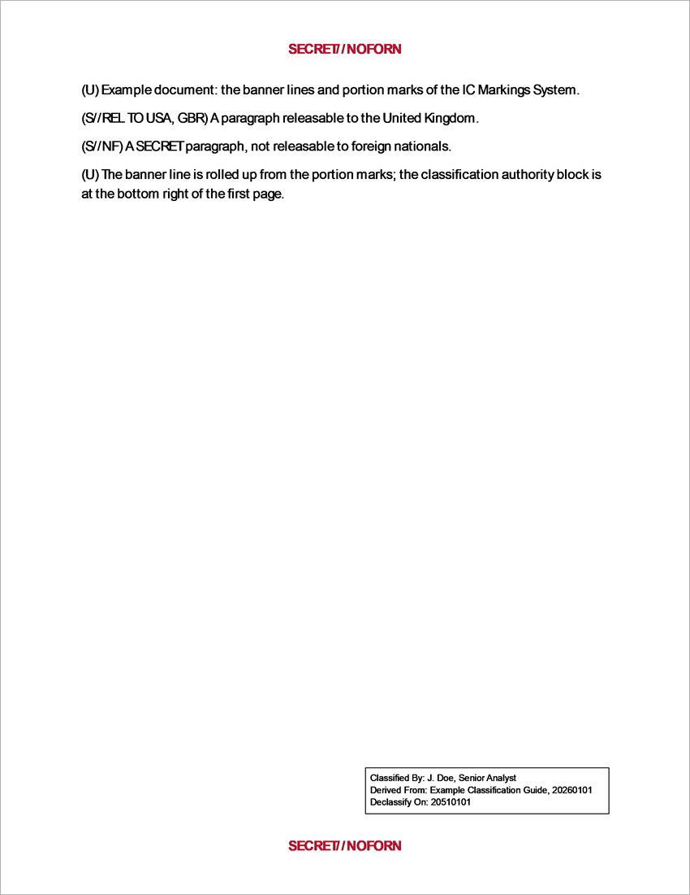 | 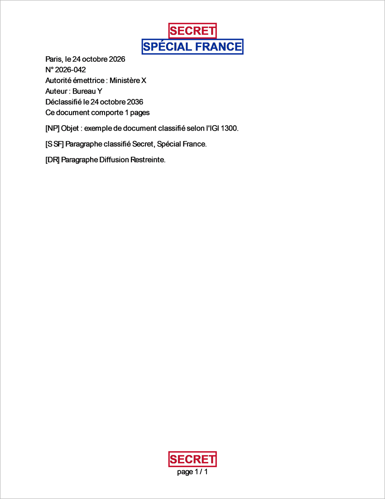 | 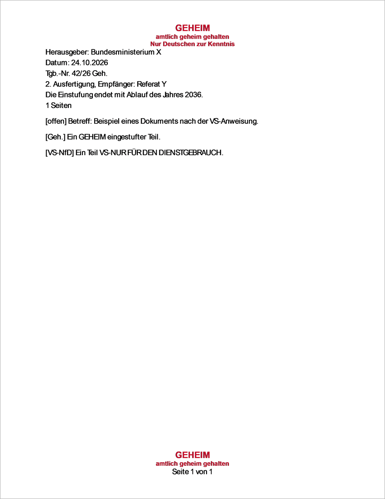 |
| **United Kingdom (GSCP)** | **European Union** | **PowerPoint (IC)** |
| 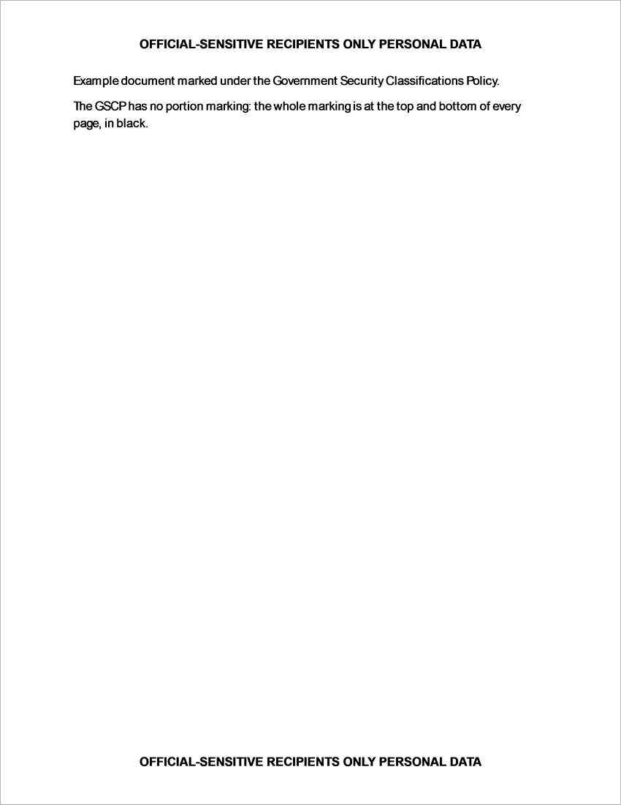 | 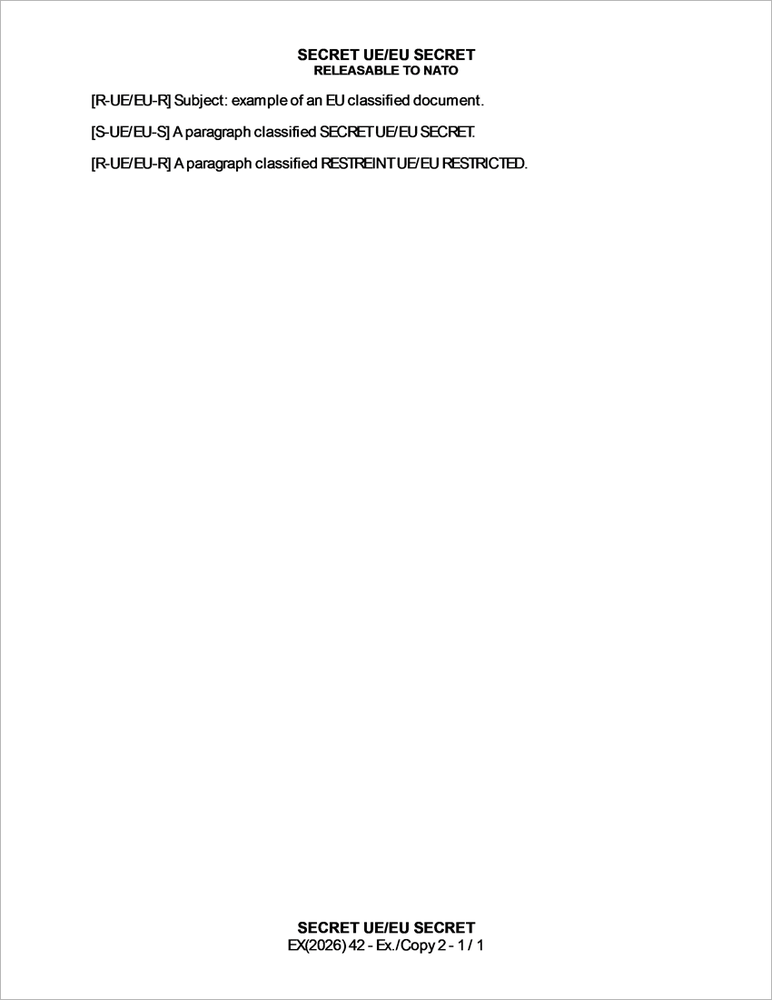 | 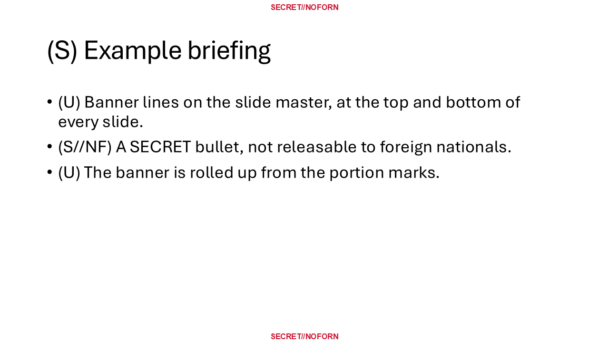 |

The dialogs, in English, with the same dialog in French and German:

| Dialog | English | Other languages |
|---|---|---|
| Choice of the system | 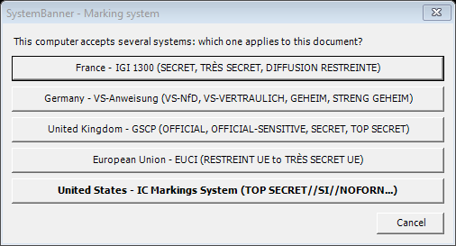 | [French](Docs/Images/Dialog_System_fr.png), [German](Docs/Images/Dialog_System_de.png) |
| IC: classify | 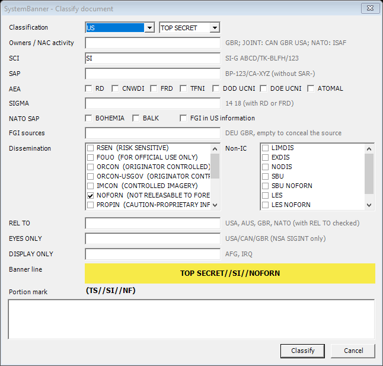 | [French](Docs/Images/Dialog_IC_Classify_fr.png), [German](Docs/Images/Dialog_IC_Classify_de.png) |
| IC: portion mark | 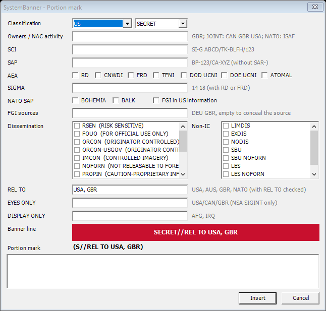 | [French](Docs/Images/Dialog_IC_PortionMark_fr.png), [German](Docs/Images/Dialog_IC_PortionMark_de.png) |
| IC: authority block | 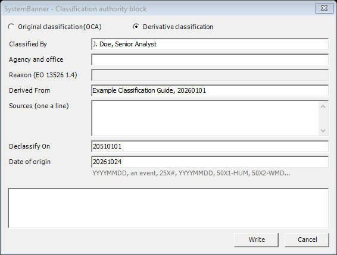 | [French](Docs/Images/Dialog_IC_AuthorityBlock_fr.png), [German](Docs/Images/Dialog_IC_AuthorityBlock_de.png) |
| France: classify | 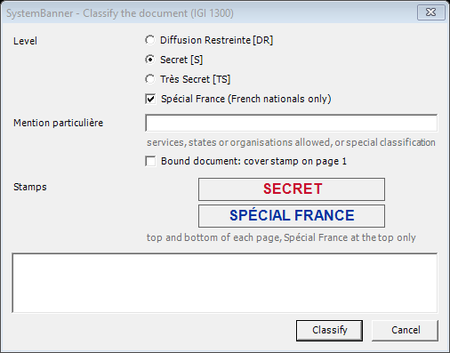 | [French](Docs/Images/Dialog_France_Classify_fr.png), [German](Docs/Images/Dialog_France_Classify_de.png) |
| France: first page | 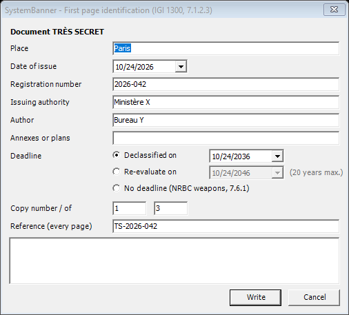 | [French](Docs/Images/Dialog_France_Identification_fr.png), [German](Docs/Images/Dialog_France_Identification_de.png) |
| France: downgrade (annexe 38) | 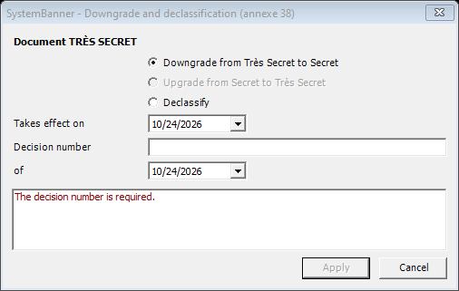 | [French](Docs/Images/Dialog_France_Downgrade_fr.png), [German](Docs/Images/Dialog_France_Downgrade_de.png) |
| Germany: classify | 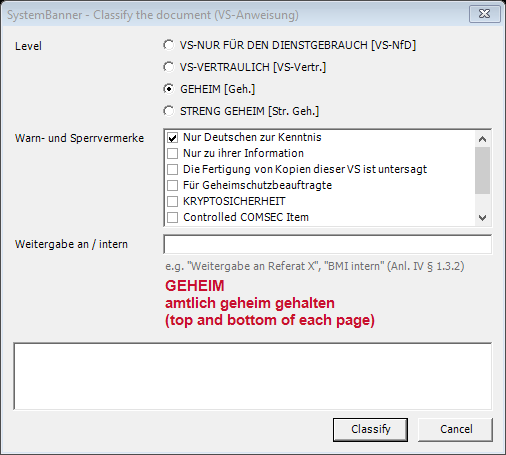 | [French](Docs/Images/Dialog_Germany_Classify_fr.png), [German](Docs/Images/Dialog_Germany_Classify_de.png) |
| Germany: first page | 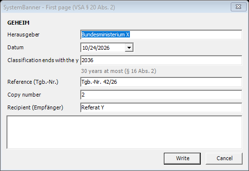 | [French](Docs/Images/Dialog_Germany_FirstPage_fr.png), [German](Docs/Images/Dialog_Germany_FirstPage_de.png) |
| Germany: downgrade | 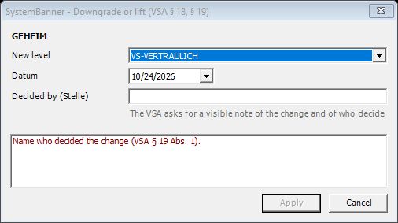 | [French](Docs/Images/Dialog_Germany_Downgrade_fr.png), [German](Docs/Images/Dialog_Germany_Downgrade_de.png) |
| United Kingdom: classify | 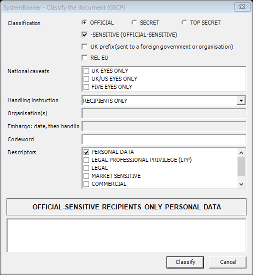 | [French](Docs/Images/Dialog_UK_Classify_fr.png), [German](Docs/Images/Dialog_UK_Classify_de.png) |
| EU: classify | 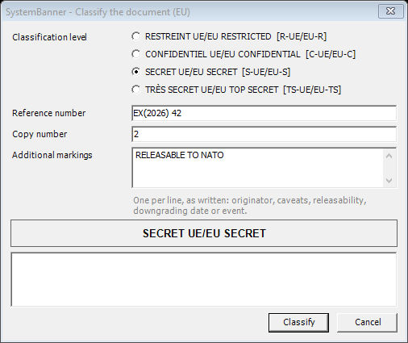 | [French](Docs/Images/Dialog_EU_Classify_fr.png), [German](Docs/Images/Dialog_EU_Classify_de.png) |

----------
REFERENCES
----------

The texts the add-in follows, in the versions read for it. Check the version in force before relying on them.

United States
- *Intelligence Community Markings System Register and Manual*, ODNI, effective 31 December 2016, released under FOIA on 7 July 2021 (case DF-2019-00061), [copy published by the Federation of American Scientists](https://sgp.fas.org/othergov/intel/ic_markings_2016.pdf). It is the latest version made public; the IC uses newer, unpublished versions.
- Executive Order 13526, *Classified National Security Information*, 29 December 2009, [National Archives](https://www.archives.gov/isoo/policy-documents/cnsi-eo.html): classification levels, reasons (section 1.4) and the authority block, as cited by the Register.
- 32 CFR Part 2001, ISOO Implementing Directive, [eCFR](https://www.ecfr.gov/current/title-32/subtitle-B/chapter-XX/part-2001): marking of classified national security information, as cited by the Register.
- Intelligence Community Directive 710, *Classification Management and Control Markings System*, [ODNI](https://www.dni.gov/files/documents/ICD/ICD-710.pdf).

France
- *Instruction générale interministérielle n° 1300 sur la protection du secret de la défense nationale*, SGDSN, approved by the arrêté of 9 August 2021, [ANSSI page with the text](https://cyber.gouv.fr/reglementation/cybersecurite-systemes-dinformation/protection-du-secret/instruction-generale-interministerielle-n1300/): section 7.1 and annexes 1, 36, 37 and 38.

Germany
- *Allgemeine Verwaltungsvorschrift zum materiellen Geheimschutz* (Verschlusssachenanweisung, VSA), Federal Ministry of the Interior, 13 March 2023, GMBl. 2023 Nr. 26-29, p. 542: § 16, § 18 to § 20 and Anlage IV. No official online copy was found; the federal VSA does not apply to the Länder, which have their own.

United Kingdom
- *Government Security Classifications Policy*, Cabinet Office, [gov.uk collection](https://www.gov.uk/government/publications/government-security-classifications) ([June 2023 PDF](https://assets.publishing.service.gov.uk/government/uploads/system/uploads/attachment_data/file/1166145/Government_Security_Classifications_Policy_June_2023.pdf), HTML version updated 5 August 2024).

European Union (every rule and its point in [Docs/EU-marking-rules.md](Docs/EU-marking-rules.md))
- Council Decision 2013/488/EU of 23 September 2013 on the security rules for protecting EU classified information, [EUR-Lex](https://eur-lex.europa.eu/eli/dec/2013/488/oj), amended by Decisions 2014/233/EU, (EU) 2019/2247, (EU) 2021/1075 and (EU) 2025/1540 (appendices only).
- Commission Decision (EU, Euratom) 2015/444 of 13 March 2015 on the security rules for protecting EU classified information, [EUR-Lex](https://eur-lex.europa.eu/eli/dec/2015/444/oj).
- Commission Decision (EU, Euratom) 2015/443 of 13 March 2015 on Security in the Commission, [EUR-Lex](https://eur-lex.europa.eu/eli/dec/2015/443/oj): sensitive non-classified information, out of scope.
- Proposal for a Regulation on information security in the institutions, bodies, offices and agencies of the Union, COM(2022) 119: not adopted when read; to check.

Software
- [SystemBanner for Windows 2000 to 7](https://github.com/Cole987/SystemBanner_XP), by Cole: the settings (`Simple`, presets and colors) this add-in reads, and its roadmap.
- [SystemBanner](https://github.com/awawrzyniak10/SystemBanner), by Aaron Wawrzyniak: the original classification banner.
- [classification-banner](https://github.com/fcaviggia/classification-banner), by Frank Caviggia: the classification banner for Linux, and the GSA form colors of the classification levels.
- [Fortra guide on implementing the DoD marking standard with classification software](https://www.fortra.com/resources/guides/easily-implement-new-dod-marking-standard-classification-software): ideas of use only (classification at save and print, document properties for mail guards); no code or text taken.

-------
CREDITS
-------

SystemBanner was created by [Aaron Wawrzyniak](https://github.com/awawrzyniak10/SystemBanner), the [Windows 2000 to 7 and Mac fork](https://github.com/Cole987/SystemBanner_XP) is by Cole. Stock classification colors are based on the GSA form color information collected by [Frank Caviggia](https://github.com/fcaviggia/classification-banner). Released under the MIT License.
